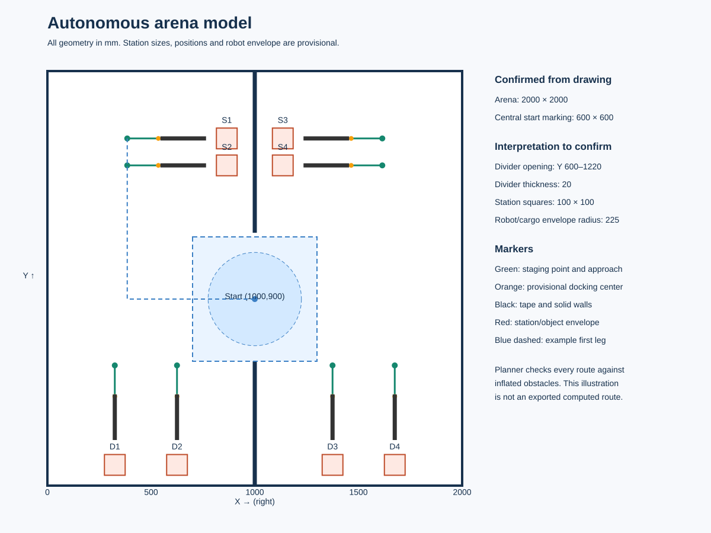
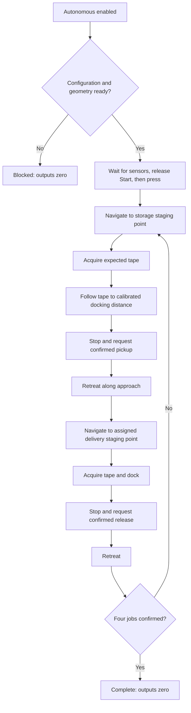

# Arena autonomous routine

**Cobra commissioning update, 23 October 2026:** the user connected the analog
module to VMX I2C and raw reads are now enabled. See [COBRA_CHECK.md](COBRA_CHECK.md)
for the focused white-floor/black-tape procedure. Session diagnostic captures
do not automatically enable autonomous tape calibration or motion.

## Implementation status

The earlier one metre exercise has been removed. The project now contains a
nonblocking mission controller, fixed arena map, collision-aware waypoint
planner, encoder/IMU localization, gated wall correction, Cobra tape tracking,
and autonomous wheel-speed feedback. Control Station selects Autonomous or
Teleoperated mode at runtime. The existing manual controls remain available.

**The complete object mission is not ready for an arena run.** Geometry,
starting heading, Cobra installation/calibration, motor tuning, station
assignment, and the manipulator need confirmation. Autonomous start is blocked
until those requirements are implemented/configured. Debug and release builds
compile and link with the installed WPILib 2020/Studica libraries; no new code
has been deployed or exercised on the physical robot in this change.

The user has specified a future mechanism with one Maverick 12 V DC motor,
two servos, and possibly one or two limit switches. Its linkage, ports,
positions, travel, homing, and object confirmation are not yet specified.
`ManipulatorConfig.h` records placeholders; `Hardware` exposes explicit action
hooks and currently returns `Unavailable`. No output is constructed for this
mechanism and no pickup/release success is simulated.

## Why this approach fits the available hardware

The arena is small and its fixed geometry is known. A fixed map with a
visibility graph, position feedback, gyro heading hold, and station-specific
tape docking fits the existing WPILib 2020 toolchain. It needs no new package,
ROS process, camera, lidar, or dependency on projects 1–6. A general SLAM stack
would add complexity without providing additional observations from the
currently installed hardware.

The drive is a three-wheel holonomic omni drive. A differential-drive path
follower would impose inappropriate wheel constraints. Instead, the controller
requests independent robot-forward, robot-left, and yaw velocities and uses
the existing three-wheel tangent model. Encoders provide translation; the VMX
gyro/AHRS provides heading. The four sonars observe known fixed walls at slow
observation points, and Cobra provides precise cross-track alignment at each
station. Tape alone cannot determine distance along a straight line: final
approach distance still comes from odometry and the calibrated gripper reach.

Studica documents four Cobra reflectance channels, a legacy analog module
connected to VMX I2C, and the `studica::Cobra::GetVoltage(channel)` API. The
installed Studica 1.1.28 header provides this API. See the
[Studica Cobra documentation](https://docs.wsr.studica.com/en/latest/docs/Sensors/cobra.html).
Confirm the actual Cobra generation: a different electrical/ADC interface
requires adapting `Hardware::ReadLine()` before installation is enabled.

## Coordinates and the arena drawing



All linear measurements are **millimetres**. Origin is the inner bottom-left
arena corner. Arena +X points right in the drawing; +Y points up. Heading is
counterclockwise positive: 0 degrees faces right, +90 faces the storages, and
-90 faces the deliveries. Robot body +X is forward and +Y is left.

| Feature | Source configuration | Confidence |
|---|---|---|
| Arena footprint | X/Y 0…2000 | Dimensioned in drawing; confirm inner wall reference faces |
| Start floor square | Approximately X 700…1300, Y 600…1200 | 600-square dimension confirmed; exact placement/reference faces inferred |
| Initial robot centre | (1000,900), heading +90 degrees | PLACEHOLDER; user cannot yet confirm |
| Lower central divider | X 990…1010, Y 0…600 | 990/600 interpreted from drawing; thickness/reference faces need confirmation |
| Upper central divider | X 990…1010, Y 1220…2000 | Top 780 dimension gives 1220; thickness/reference faces need confirmation |
| Passable opening | Y 600…1220 | Interpretation; confirm physical opening and 20 mm offset from floor marking |
| Storage/delivery square size | 100 × 100 | PLACEHOLDER: square size is not explicitly dimensioned |
| Robot/cargo circular envelope | Radius 225 | PLACEHOLDER; must contain the complete footprint at every mechanism position |
| Extra navigation clearance | 40 | Initial conservative setting; tune against uncertainty and actual clearances |

The central square is treated as a **floor marking**, not a solid 600 mm
obstacle. The vertical divider segments are solid obstacles. This distinction
is supported by the perspective illustration but still needs physical
confirmation. Station squares are conservatively treated as occupied object
envelopes even after pickup: the planner never drives across them.

### Provisional stations

| ID | Centre (X,Y) | Docking heading | Staging centre | Docking centre |
|---|---|---|---|---|
| S1 upper left | (865,1675) | 0 deg | (385,1675) | (535,1675) |
| S2 lower left | (865,1545) | 0 deg | (385,1545) | (535,1545) |
| S3 upper right | (1135,1675) | 180 deg | (1615,1675) | (1465,1675) |
| S4 lower right | (1135,1545) | 180 deg | (1615,1545) | (1465,1545) |
| D1 leftmost | (325,100) | -90 deg | (325,580) | (325,430) |
| D2 | (625,100) | -90 deg | (625,580) | (625,430) |
| D3 | (1375,100) | -90 deg | (1375,580) | (1375,430) |
| D4 rightmost | (1675,100) | -90 deg | (1675,580) | (1675,430) |

These are configuration placeholders, not exact dimensions extracted from
image pixels. Storage X assumes a 75 mm gap from the central wall to a
100 mm square. Storage Y assumes the upper square's top is 275 mm below the
top wall and a 30 mm gap between rows. Delivery X assumes 100 mm squares,
200 mm gaps within each pair, and 275 mm outer edge margins. Delivery Y assumes
a 50 mm bottom gap. Verify these reference faces before using the coordinates.

Staging is 480 mm from the station centre; docking is 330 mm away, along the
outward approach. The difference is 150 mm of tape-guided travel. Both values
depend on the gripper reach and sensor position. Cobra's placeholder forward
offset is 180 mm, giving a sensing face within the illustrated tape during
the approach. The 220 mm tape length, 20 mm width, and 50 mm gap must also be
confirmed against the actual floor. The illustration shows inferred tape;
the runtime uses a known straight line at the station plus an association
window, rather than treating the entire arena as a line network.

### Clearance calculation

The planner inflates every solid rectangle by robot envelope radius plus
clearance. With the provisional values, that is 225 + 40 = 265 mm. The
620 mm divider opening permits centre Y between 865 and 955 mm, only a
90 mm interval. A radius of 270 mm or larger would not fit with this clearance.
The preflight geometry check rejects this situation.

The circular envelope is deliberately independent of heading. Measure the
maximum radius with the mechanism moving AND a piece carried. A larger envelope
can make the current station approaches infeasible; change docking standoff
and routing only after checking actual geometry.

## Mission assignment and execution

The user will provide a specific storage-to-delivery assignment and order.
`JOBS` currently contains `{0,0}, {1,1}, {2,2}, {3,3}` solely as a placeholder.
Indices are zero based; displayed station labels are one based. Leave
`STATION_ASSIGNMENTS_CONFIRMED=false` until the real sequence is entered.



Planning checks the start, every requested station, all connecting routes,
and each docking corridor before motion. Invalid assignment indices and
infeasible envelope/docking geometry block the mission. Runtime checks then
revalidate the actual segment after pose corrections.

The visibility graph uses corners of inflated divider/object rectangles.
Dijkstra selects a short collision-free route; the current mission order is
not optimized because it is externally specified. Long segments are split
into observations at most 600 mm apart. Every waypoint requires position
within 12 mm, heading within about 2 degrees, and a 0.70 s observation stop.
The planner will route through the centre opening when switching sides;
there is no straight command across a solid divider.

Tape acquisition is a bounded lateral sweep (up to 30 mm) at staging,
not unrestricted forward travel. Three consecutive valid readings are
required. Docking uses the tape centroid for lateral velocity, holds station
heading, and uses odometry for distance along the tape. Loss of tape commands
zero immediately; loss lasting over 0.25 s faults the run. The 45 mm station
window limits accidental association with the adjacent storage row.

After a confirmed action, the robot retreats along the approach before
planning the next leg. A delivery is counted only after confirmed release and
retreat. Default 8 s mechanism, 35 s motion-leg and 180 s mission timeouts are
initial placeholders, not competition timing guarantees.

## Motion and localization

### Shared wheel/body frame

The original one metre run moved left. Manual driving subsequently used an
empirical -90 degree layout correction. Previously the inverse encoder model
did not apply the corresponding inverse rotation. Now `DriveKinematics.h`
provides both transformations, using `DRIVE_FORWARD_DIRECTION_DEG=-90`:

1. Hardware rotates body forward/left requests into the wheel-layout frame.
2. The tangent wheel model converts layout velocity and yaw into wheel speeds.
3. Localization solves the inverse wheel equations, then rotates layout
   velocity back into the body frame before integrating arena pose.

Manual drive now passes forward/left components directly to Hardware; it does
not pre-rotate them a second time. Existing manual output directions and the
user's 90% cap are preserved. Autonomous frame confirmation remains false:
physical translation, yaw polarity, and IMU alignment still need confirmation.

### Encoder, IMU and acceleration

Wheel radius remains the user-set 51 mm and wheel centre radii remain 168 mm.
M0/M1/M2 radial angles remain 150/30/270 degrees. The scale is 1464 counts per
gearbox output revolution, with external gear ratio currently 1.0.

Yaw prediction uses gyro rate with 10% encoder yaw contribution, then corrects
toward AHRS yaw. The navX sign conversion remains CCW positive. Autonomous
entry snapshots encoder baselines and aligns the existing AHRS heading to the
known arena start pose without asynchronous encoder/yaw resets.

Raw acceleration and gyro channels remain readable. Linear acceleration is
captured, and the AHRS internally uses inertial sensor fusion; independent
acceleration integration has been disabled by default (`ACCEL_VELOCITY_BLEND=0`)
to prevent bias from moving a stationary pose. Accelerometers do not measure
planar yaw on their own. Position covariance grows mainly with measured motion;
stationary waiting accumulates only small background uncertainty.

### Autonomous wheel control

Autonomous wheel commands use a per-wheel feedforward + PI speed controller
with Titan encoder velocity, conditional integration against saturation, and
integrator reset on stop. The feedforward scale is based on 112 output RPM
and the 102 mm wheels, approximately 598.16 mm/s. See the
[Maverick specifications](https://docs.wsr.studica.com/en/latest/docs/Motors/maverick-dc-motor.html).
The 61:1 gearbox is already included; external gearing is separate.

Starting values are 220 mm/s cruise, 70 mm/s docking, 300 mm/s² translation
acceleration, 0.6 rad/s yaw, 1 rad/s² yaw acceleration and a 45% autonomous motor
cap. Wheel requests are scaled together when necessary before feedback;
individual PI corrections can still saturate. The `WHEEL_KS/KP/KI` values are
placeholders and `WHEEL_SPEED_CONTROL_CONFIRMED` remains false. No physical
tracking accuracy is claimed. Manual drive keeps its original open-loop mixer.

### Sonar correction and proximity stop

One sonar is triggered at a time; 60 ms echo settling plus 40 ms quiet spacing
gives roughly a 400 ms four-sensor cycle. VMX requires Control Station enable
for FlexDIO trigger outputs. Disabled readings are invalidated.

Wall prediction now raycasts against outer walls AND both central divider
segments. Station/object envelopes occlude those walls and are not trusted
localization references. Side rays at ±5 degrees must agree on the wall and
have similar predicted ranges. Finite-difference neighborhood checks,
100 mm residual gating, a three-sigma innovation check and a 20 mm maximum
position update reduce accidental jumps. Accepted external heading changes
also adjust the AHRS offset so the next AHRS update retains the correction.

Fusion requires speed at most 60 mm/s and yaw rate at most 8 deg/s at both
ping and receipt; reading age must be at most 0.12 s. This avoids applying a
delayed measurement as though it were captured at the latest fast-moving
pose. It is a conservative approximation, not a timestamped history estimator.
Observation stops provide time for these slow measurements.

Raw sonar ranges also gate commanded motion toward a beam. A stale/invalid
reading in that direction or a range inside the configured envelope plus an
estimated stopping distance causes a fault and zero output. This protection
uses the assumed acceleration/braking capability and needs calibration.
There is **no forward sonar** and the beams do not cover every direction;
this is not general obstacle avoidance. Unexpected objects, corners, wide
echo cones and reflective surfaces can still defeat a sparse sonar system.

### Tape correction

Each Cobra channel is normalized from measured floor/tape voltages, supporting
either tape polarity. A weighted centroid yields tape offset in millimetres.
Weak signals, all-channels-dark patches and overly broad detections are
rejected. Channel order and spacing are calibration inputs.

Only stable docking reads on the expected station line can correct arena
cross-track position/heading. Corrections are limited to once per 0.20 s;
large disagreement is rejected. A single transverse array does not independently
measure a full pose or absolute distance along the tape. Encoder/AHRS and wall
observations remain necessary.

## Manipulator integration contract

Implement these `Hardware` methods with a nonblocking mechanism controller:

| Method | Required meaning |
|---|---|
| `IsObjectHandlerReady()` | Mechanism configured, usable, and homed if needed |
| `BeginObjectAction(Pickup/Release)` | Start an action once, clear old completion, return promptly |
| `GetObjectActionStatus()` | `Busy`, physically confirmed `Complete`, or `Failed`; current stub returns `Unavailable` |
| `StopObjectHandler()` | Cancel motion immediately on disable, fault or mode change; leave servos in a defined safe state |

The currently unused Titan M3 is a proposed motor/encoder port, not confirmed
wiring. Servo PWM and limit-switch DIO channels remain -1 in
`ManipulatorConfig.h`. Do not instantiate outputs on guessed channels.
The mechanism needs its own per-loop update, limit enforcement and action
confirmation. Setting `CONFIGURED=true` alone intentionally does not make
the `Hardware` stub report readiness.

Needed details: motor direction/function and gearing, whether encoder feedback
is available, upper/lower limits, safe servo ranges, open/closed positions,
pickup/release sequence, carried-object envelope, and evidence that a piece
was acquired/released. Limit switches alone may only confirm lift position.

## Calibration and operation

Main configuration files:

| File | Contents |
|---|---|
| `LocalizationConstants.h` | Wheel geometry, signs, shared frame, sonar mounts/IO, known start pose, manual controls |
| `AutonomousConfig.h` | Map, stations, job list, footprint, Cobra, controller tuning, timeouts, confirmation flags |
| `ManipulatorConfig.h` | Future motor/servo/limit placeholders |

Before a run, confirm arena reference faces and divider dimensions, complete
the footprint and sensor measurements, enter the user's assignment/order,
calibrate Cobra on actual tape/floor, tune wheel-speed control, verify body/IMU
axes and encoder signs, and implement the manipulator. Then set only the
corresponding confirmation flags whose measurements were actually checked.
Changing flags is not a substitute for those measurements.

For future configured operation:

1. Place the robot at the measured start centre and heading; keep it still
   until IMU calibration completes.
2. Connect Control Station and Shuffleboard. Select Autonomous and enable.
3. Read **Autonomous → Mission status**. A configuration error blocks motion.
   Four fresh sonars, IMU readiness and valid odometry are required before Start.
4. Release the physical Start button, then press it for at least 60 ms.
5. Disable at any time to stop drive/mechanism. Re-enabling starts a new
   autonomous session requiring repositioning and a new Start press. There is
   no automatic resume of an interrupted pickup mission.

IMU loss, invalid pose/timing, excessive estimated uncertainty, control gaps
over 0.10 s, blocked geometry, stale/close sonar in the commanded direction,
line failure, lack of movement progress or mechanism failure stops the run.
Zero output is not a guarantee of zero mechanical coasting. Nothing in this
change has been deployed automatically.

## Dashboards and code layout

**Teleop** retains four rows of manual controls, encoders and motor outputs.
**Autonomous** has four rows: mission/enabled/start, pose/delivery count,
four sonar distances, then tape/IMU/uncertainty/station/job. **Calibration**
separates preflight reasons, four Cobra voltages and selected inertial readings.
LiveWindow remains disabled. Old client-saved Robot/Forward widgets can be
removed in Shuffleboard; the program no longer publishes those exercises.

`ArenaMap` handles planning/raycast geometry; `AutonomousController` handles
mission states and velocity requests; `Localization` handles pose estimation;
`Hardware` handles VMX/Titan/Cobra and wheel feedback;
`LocalizationSubsystem` coordinates sensor polling, controller mode and output
ownership. The standard command scheduler calls the subsystem each tick.
There is one hardware-owning process and no blocking movement loop.

Removed: `ForwardDriveController`, its dedicated checks, template Example
command/subsystem, empty template Constants, example deploy file, and the
unused null autonomous-command plumbing. Historical observations remain in
`PROJECT_NOTES.md`. Gradle, vendor files, wrapper and project parameters have
not been changed.

Build from this project folder with the existing WPILib 2020 JDK:

```powershell
$env:JAVA_HOME = 'C:/Users/Public/wpilib/2020/jdk'
.\gradlew.bat assemble -PteamNumber=23 --offline --console=plain
```

This compiles/links the robot program; it does not deploy or validate physical
motion, the inferred map, sensor calibration or object handling.
